# Flachbandkabel: gute und schlechte Praxis mit Simulationen

Stand: 14.11.2026

## Kernaussagen

Die Pinbelegung ist der größte Hebel: Von „ein GND“ zu „S-G-S-G“ sinkt die Gleichtaktquelle um rund 25 dB, das Übersprechen um 20 dB. Die Chassisanbindung am Stecker ist der zweite Hebel. Flache Führung auf dem Blech hilft nur zusammen mit dieser Anbindung.

- **Pinbelegung:** Ein Signal mit nur einer GND-Ader ist ein symmetrisches Paar, h = 0,5. Mit S-G-S-G sinkt h auf 0,04–0,05; Δh fällt von 0,48 auf 0,02–0,03.

- **Höhe über Blech ändert h kaum.** Das gilt, solange das Blech nur Bezug ist. Mit Chassisanbindung wird es Rückleiter; dann ist der Sprung gegenüber der Umgebung frei im Raum rund 8-mal (18 dB) größer als flach am Blech.

- **Flach am Blech** senkt die magnetische Kopplung auf ein Nachbarkabel um rund 30 dB und hält das Kabel von Öffnungen fern.

- **Ohne Chassisanbindung ist flach am Blech schlechter** (+10 dB Platinenpotential): Das Kabel hat mehr Kapazität zum Blech und zieht die schwimmende Platine mit.

- **Mit Anbindung am Stecker** sinkt das Platinenpotential bei 50 MHz um rund 35 dB, bei 150 MHz um rund 16 dB. Darüber begrenzen Resonanzen aus Bolzeninduktivität und Kabelkapazität; die Anbindung muss dann unter 1 nH liegen.

**Warum frei im Raum in der Praxis viel mehr abstrahlt:** Mit Chassisanbindung wird das Blech Teil des Rückleiters. Gegenüber der Umgebung ist der Imbalance-Sprung dann beim hoch geführten Kabel rund 8-mal so groß wie beim flachen (− 18 dB für flach). Dazu kommen − 12 bis − 27 dB an Öffnungen und − 31 dB zu Nachbarkabeln. Nur der Weg über die Bolzen spricht gegen flach (+13 dB bei 4 nH) – mit ≤ 1 nH Anbindung entfällt das (Abbildungen 12 und 13).

Alle Zahlen stammen aus vereinfachten 2D- und Leitungsmodellen. Sie zeigen Tendenzen und Größenordnungen, keine Messwerte.

## Modell und Annahmen

Das Flachband wird als Mehrleitersystem über dem Gehäuseblech gerechnet: 20 Adern, Raster 1,27 mm, Leiterradius 0,19 mm (AWG 28), Isolation vernachlässigt (Luft). Das Blech ist ein idealer Leiter; seine Wirkung wird über Spiegelladungen und Spiegelströme abgebildet.

| Größe                          | Wert                          | Bemerkung                                   |
|--------------------------------|-------------------------------|---------------------------------------------|
| Kabellänge                     | 25 cm                         | zwischen zwei Platinen                      |
| Höhe „flach auf Blech“         | 3 mm                          | Leitermitte über Blech                      |
| Höhe „frei im Raum“            | 40 mm                         | Bogen über den Platinen                     |
| Takt                           | 50 MHz, 3,3 V, Flanke 1 ns    | ungerade Harmonische                        |
| h Leiterbahn auf Platine       | 0,02                          | Bezug für Δh                                |
| Platine → Blech ohne Anbindung | 30 pF                         | ca. 100 cm² in 3 mm Abstand                 |
| Anbindung am Stecker           | 4 nH (Variation 0,5–4 nH)     | 2 Bolzen à 8 nH parallel                    |
| Externes Kabel an Platine A    | 150 Ω Gleichtaktimpedanz, 1 m | typisch für Messaufbauten                   |
| Gleichtakt-Wellenwiderstand    | 32 Ω (3 mm) / 134 Ω (40 mm)   | Streifen zwischen Boden und Deckel (100 mm) |
| Güte der Kabelresonanzen       | 10                            | Verluste und Abstrahlung pauschal           |

Die vier Rechnungen:

1.  **Elektrostatik:** Kapazitätsmatrix aus Potentialkoeffizienten, daraus der Imbalance-Faktor h = C_S/(C_S + C_R) des Taktleiters gegenüber der zusammengefassten GND-Gruppe.

2.  **Induktivität und Übersprechen:** L = µ₀ε₀·C⁻¹ (homogenes Medium), Schleifeninduktivität Takt ↔ Rückleiter, Rückwärts-Übersprechen K_b = ¼(L_m/L + C_m/C).

3.  **Magnetische Kopplung:** Gegeninduktivität zwischen der Taktschleife und einem Nachbarkabel über dem Blech, 30 mm neben der letzten Ader.

4.  **Gleichtakt-Leitungsmodell:** Das Kabel als Leitung über dem Blech, an beiden Enden mit V_CM = Δh · V_DM gegen die Platinen gespeist. Platinen über Kapazität oder Bolzen ans Blech. Ergebnis ist das Potential der Platinenmasse gegenüber dem Chassis; daraus und aus der direkten Feldkopplung auf 10 cm interne Verdrahtung der Strom auf dem externen Kabel und eine Feldstärkeabschätzung in 10 m.

Ergänzt: Imbalance-Faktor zusätzlich mit Bezug „Umgebung“ (Kreis 1 m, Blech 20 cm breit als Teil des Rückleiters bei Anbindung) und daraus ein dritter Pfad aufs externe Kabel mit Leckfaktor 0,1.

Das Python-Skript, das alle Abbildungen erzeugt, liegt unter [`simulation/sim.py`](simulation/sim.py). Parameter lassen sich dort ändern.

## Pinbelegungen

Vier typische Belegungen eines 20-poligen Flachbands werden verglichen, von der häufigsten Fehlbelegung bis zur Empfehlung. In jeder liegt ein Takt (T) als Störer und ein Analogsignal (A) als Opfer direkt daneben.

| Variante                               | GND-Adern | Takt              | typischer Ursprung                               |
|----------------------------------------|-----------|-------------------|--------------------------------------------------|
| V1: 1 × GND am Rand, Takt am Gegenrand | 1         | 23 mm vom GND     | Steckerbelegung „nach Layout“, GND nur auf Pin 1 |
| V2: 1 × GND am Rand, Takt daneben      | 1         | 1,27 mm vom GND   | gut gemeint, aber nur ein Rückleiter             |
| V3: 3 × GND (Ränder + Mitte)           | 3         | 5 mm vom GND      | häufiger Kompromiss bei Pinmangel                |
| V4: S-G-S-G, beide Ränder GND          | 11        | zwischen zwei GND | Empfehlung für Takte und schnelle Busse          |

**Abbildung 1** (unten) zeigt die Belegungen als Querschnitt.

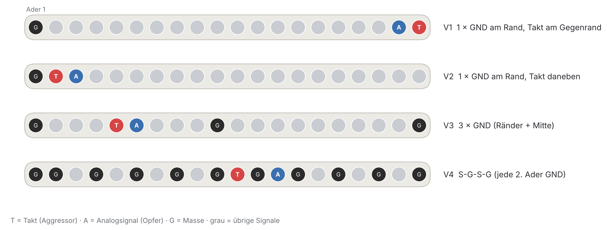

*Abbildung 1: Vier Pinbelegungen eines 20-poligen Flachbands. T = Takt, A = Analogsignal, G = Masse.*

## Simulation 1: Feldbild, Imbalance-Faktor und Schleifeninduktivität

Mit nur einer GND-Ader ist h = 0,5 – unabhängig davon, ob der Takt neben oder fern vom GND liegt. Ein Signal und ein Rückleiter gleicher Geometrie sind ein symmetrisches Paar: Die Hälfte der Gegentaktspannung erscheint als Gleichtakt. Erst zusätzliche GND-Adern, die den Takt umschließen, senken h.

| Variante                | h (3 mm) | h (40 mm) | Δh zur Platine | V_CM bei 0,67 V (150 MHz) | Schleifeninduktivität 25 cm |
|-------------------------|----------|-----------|----------------|---------------------------|-----------------------------|
| V1: 1 GND, Takt fern    | 0,50     | 0,50      | 0,48           | 320 mV                    | 480 nH                      |
| V2: 1 GND, Takt daneben | 0,50     | 0,50      | 0,48           | 320 mV                    | 190 nH                      |
| V3: 3 GND               | 0,23     | 0,20      | 0,18–0,21      | 120–140 mV                | 225 nH                      |
| V4: S-G-S-G             | 0,05     | 0,04      | 0,02–0,03      | 14–21 mV                  | 118 nH                      |

V1 → V4 bedeutet 23–27 dB weniger Gleichtaktquelle. V2 hilft nur bei der Gegentaktschleife (− 8 dB Induktivität, kleinere Schleifenfläche), nicht beim Gleichtakt.

**Abbildung 2** zeigt das Feld bei Gegentaktanregung. Bei V1 reicht das Feld des Takts weit in den Raum und endet zu einem großen Teil auf dem Blech – das ist der Gleichtaktanteil. Bei V4 schließt es sich fast vollständig auf den beiden Nachbar-GND-Adern.

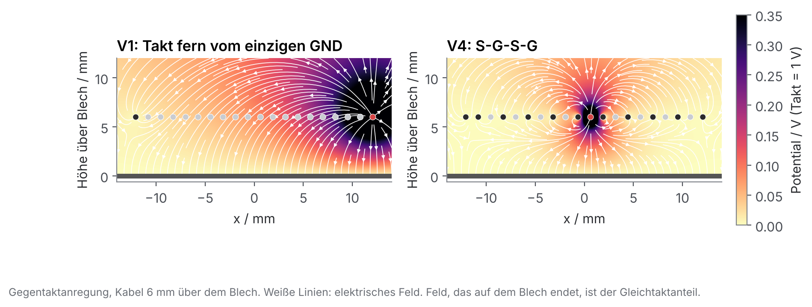

*Abbildung 2: Potential und Feldlinien bei Gegentaktanregung, Kabel 6 mm über dem Blech.*

## Simulation 2: Höhe über dem Blech

Die Höhe verändert h nur wenig: Zwischen 1 mm und 40 mm bleibt h bei V1/V2 exakt 0,5, bei V3 zwischen 0,20 und 0,25, bei V4 zwischen 0,04 und 0,07. Dicht am Blech steigt h sogar leicht, weil der Takt dort stärker zum Blech koppelt als die etwas weiter entfernten GND-Adern.

Die Gleichtaktquelle V_CM entsteht also am Stecker, egal wie das Kabel liegt. Was die Höhe ändert, ist der Weg, den der Gleichtaktstrom danach nimmt (Simulation 4), und wie stark das Kabel auf seine Umgebung wirkt:

- **Magnetische Kopplung auf ein Nachbarkabel** (Abbildung 8): Liegen Flachband und Nachbarkabel 3 mm statt 40 mm über dem Blech, sinkt die Kopplung um 31 dB (V1) bzw. 35 dB (V3). Die Spiegelströme im Blech kompensieren das Feld.

- **Pinbelegung und Höhe addieren sich:** V4 am Blech koppelt 84 dB schwächer als V1 im Raum. V4 im Raum liegt mit − 59 dB schon deutlich besser als V1 am Blech (− 31 dB).

- **Abstand zu Öffnungen:** Ein Kabel am Bodenblech ist 8–10 cm von Lüftungsschlitzen im Deckel entfernt, ein Bogen oft nur 1–2 cm. Das Nahfeld fällt mindestens mit dem Quadrat des Abstands.

**Abbildung 3** zeigt h über der Höhe, **Abbildung 8** die magnetische Kopplung.

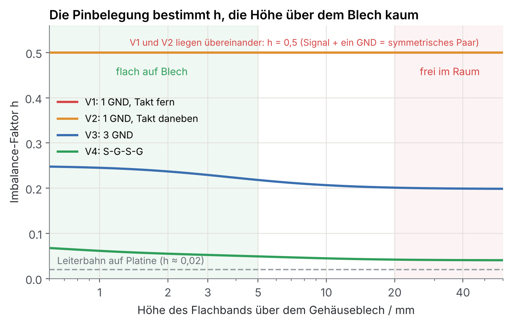

*Abbildung 3: h über der Höhe des Flachbands; V1 und V2 liegen bei 0,5 übereinander.*

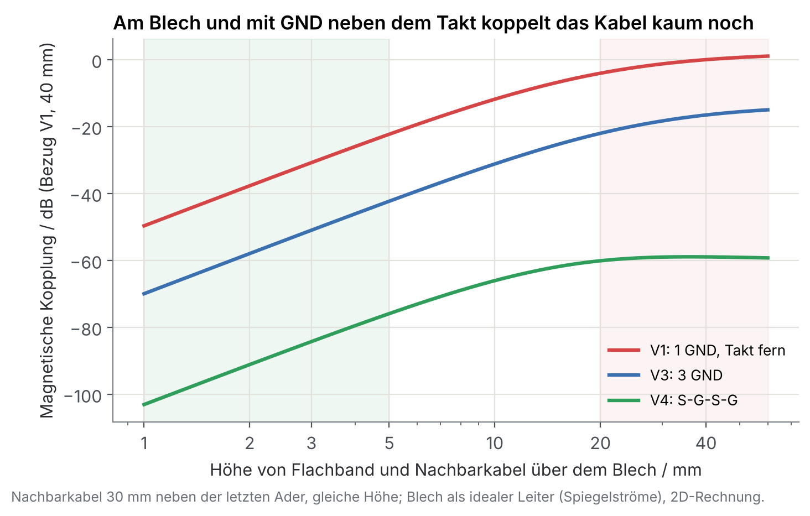

*Abbildung 8: Magnetische Kopplung auf ein Nachbarkabel 30 mm daneben, beide gleich hoch über dem Blech.*

### Zwei Bezugssysteme für h

Welcher Imbalance-Faktor zählt, hängt davon ab, wo der Gleichtaktstrom zurückfließt. Mit Chassisanbindung ist der Sprung beim hoch geführten Kabel rund 8-mal so groß wie flach am Blech.

| Bezug                                  | gilt für                                   | V1 flach 3 mm | V1 frei 40 mm | V4 flach | V4 frei |
|----------------------------------------|--------------------------------------------|---------------|---------------|----------|---------|
| Blech (Blech ist nur Bezug)            | Platine gegen Chassis, ohne Anbindung      | 0,50          | 0,50          | 0,05     | 0,04    |
| Umgebung (Blech gehört zum Rückleiter) | ganzes Gerät gegen Umgebung, mit Anbindung | 0,008         | 0,052         | 0,0025   | 0,0058  |

- **Ohne Anbindung** ist das Blech kein Rückleiter. h bleibt bei V1 bei 0,5, egal wie hoch das Kabel liegt.

- **Mit Anbindung** verhält sich ein flaches Kabel fast wie eine Leiterbahn über einer Massefläche (h Platine ≈ 0,002). Δh fällt von 0,050 (frei) auf 0,006 (flach): − 18 dB.

- Dieser Sprung regt das ganze Gerät gegenüber der Umgebung an. Er wirkt durch Display-Fenster, Kunststofffront, Lüftung und Buchsen ohne 360°-Schirmanbindung nach außen.

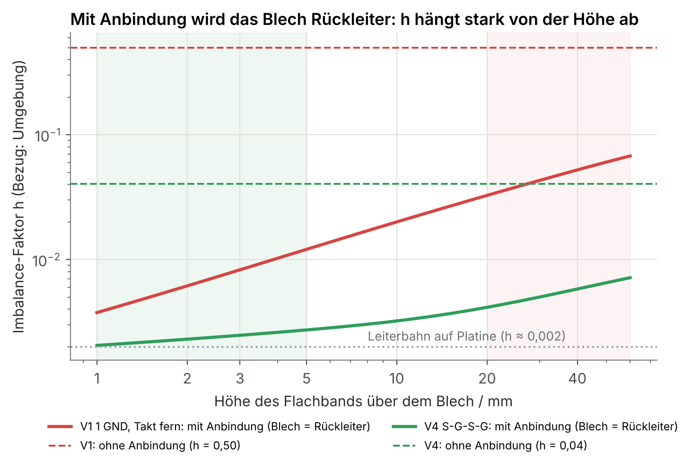

*Abbildung 11: Imbalance-Faktor gegenüber der Umgebung. Mit Anbindung steigt h mit der Höhe stark an; ohne Anbindung bleibt er hoch.*

### Welche Formel wann?

Nicht „Boden oder Raum“ entscheidet, sondern ob der Rückstrom in einem nahen Leiter fließt.

| Situation                                             | Formel                                             | Fläche / Länge                                    |
|-------------------------------------------------------|----------------------------------------------------|---------------------------------------------------|
| Kabel über Blech, im Metallgehäuse (flach oder Bogen) | kleine Schleife: E ≈ 1,316·10⁻¹⁴ · f² · A · I / r  | A = Länge × Höhe: 7,5 cm² flach, ca. 65 cm² Bogen |
| Externes Kabel, Kunststoffgehäuse, Metall weit weg    | Gleichtakt-Antenne: E ≈ 1,257·10⁻⁶ · f · I · L / r | L = Kabellänge                                    |

Die Schleifenformel gilt, solange die Höhe klein gegenüber λ/2π ist (bei 150 MHz ca. 32 cm). Wer für den Bogen im Gehäuse die Gleichtaktformel nimmt, überschätzt um rund 24 dB (bei 3 mm Höhe um 47 dB). Das Verhältnis beider Formeln ist 9,5·10⁷ / (f · H).

## Simulation 3: Übersprechen Takt → Analogsignal

Liegt das Analogsignal direkt neben dem Takt und fehlt eine GND-Ader dazwischen, koppeln 0,6–1,1 V Spitzen ein. Das betrifft z. B. die Sollwert- oder Sensorleitung eines Laserdioden- oder TEC-Reglers.

| Variante                                   | frei im Raum (40 mm) | auf Blech (3 mm) |
|--------------------------------------------|----------------------|------------------|
| V1: 1 GND, Takt fern                       | 1108 mV              | 752 mV           |
| V2: 1 GND, Takt daneben                    | 818 mV               | 641 mV           |
| V3: 3 GND                                  | 916 mV               | 733 mV           |
| V4: S-G-S-G (GND zwischen Takt und Analog) | 99 mV                | 74 mV            |

Werte für 3,3-V-Takt mit 1 ns Flanke und 25 cm Kabel (Rückwärts-Übersprechen gesättigt).

- Eine GND-Ader zwischen Takt und Analogsignal bringt rund 20 dB. Kein anderes Mittel wirkt so stark.

- Die Höhe über dem Blech bringt nur 2–3 dB, weil die Kopplung zwischen direkten Nachbaradern dominiert.

- Analogsignale gehören deshalb auf ein eigenes Kabel oder mit mindestens einer GND-Ader Abstand zu jedem Takt. Sollwerte im mV-Bereich vertragen auch 74 mV Spitzen nicht ohne Filterung.

**Abbildung 4** zeigt Übersprechen und Schleifeninduktivität im Vergleich.

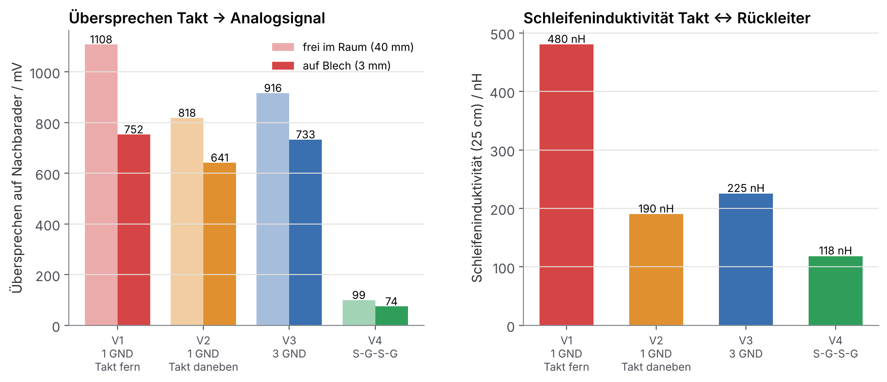

*Abbildung 4: Links Übersprechen Takt → Analogsignal, rechts Schleifeninduktivität der Taktschleife (25 cm).*

## Simulation 4: Auf Blech mit Anbindung vs. frei im Raum ohne Anbindung

Die Chassisanbindung entscheidet, ob die Gleichtaktspannung im Gerät bleibt. Ohne Anbindung hebt das Flachband die gesamte Platinenmasse gegenüber dem Chassis an, und jedes externe Kabel an dieser Platine strahlt. Mit Anbindung direkt am Stecker sinkt dieses Potential bei 50 MHz um 35–37 dB, bei 150 MHz noch um 15–17 dB.

**Was physikalisch passiert** (Abbildung 7):

- Am Stecker entsteht V_CM = Δh · V_DM. Das Kabel liegt damit um V_CM über beiden Platinen.

- Der Gleichtaktstrom fließt über die Kapazität Kabel → Blech und muss zur Platine zurück.

- **Ohne Anbindung** gibt es nur die Kapazität der Platine zum Blech (30 pF) und die externen Kabel. Es entsteht ein kapazitiver Teiler: Die Platine schwimmt auf einem Bruchteil von V_CM, das externe Kabel führt den Rückstrom.

- **Mit Anbindung** fließt der Strom über den Bolzen zurück. Die Platine liegt nur um I · jωL_Bolzen über dem Chassis.

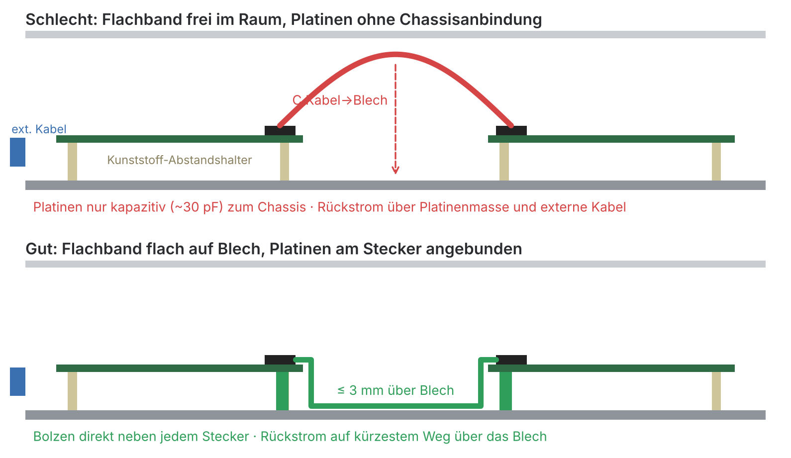

*Abbildung 7: Oben Flachband frei im Raum, Platinen auf Kunststoff-Abstandshaltern; unten flach am Blech, Bolzen direkt am Stecker.*

**Platinenpotential relativ zu V_DM** (Pinbelegung V1, Abbildung 5):

| Fall                               | 50 MHz | 150 MHz | 250 MHz |
|------------------------------------|--------|---------|---------|
| Frei im Raum, ohne Anbindung       | 0,044  | 0,042   | 0,051   |
| Auf Blech, ohne Anbindung          | 0,143  | 0,151   | 0,125   |
| Frei im Raum, mit Anbindung (4 nH) | 0,0006 | 0,0063  | 0,026   |
| Auf Blech, mit Anbindung (4 nH)    | 0,0026 | 0,028   | 0,132   |

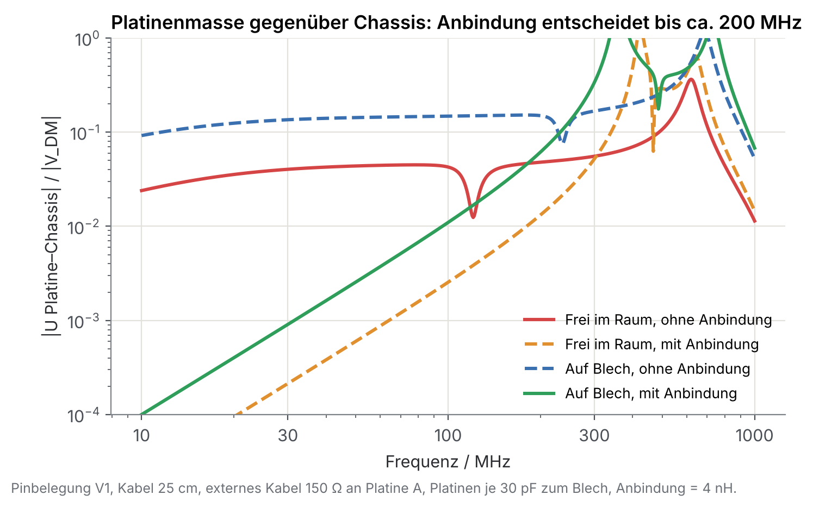

*Abbildung 5: Potential der Platinenmasse gegenüber dem Chassis, bezogen auf V_DM, für die vier Fälle.*

Zwei Ergebnisse widersprechen der Faustregel „immer flach aufs Blech“:

1.  **Flach am Blech ohne Anbindung ist schlechter als frei im Raum** (+10 dB). Das flache Kabel hat etwa 25 pF zum Blech statt 5 pF und zieht die schwimmende Platine stärker mit.

2.  **Mit Anbindung steigt der Strom über den Bolzen, wenn das Kabel flach liegt.** Bolzeninduktivität und Kabelkapazität bilden eine Resonanz; mit 4 nH liegt sie bei 350–450 MHz.

**Feldstärke in 10 m über ein 1 m langes externes Kabel** (Abbildung 6, Klasse-B-Grenzwert 30 dBµV/m bis 230 MHz, 37 dBµV/m darüber):

| Fall                               | V1: 50 / 150 / 250 MHz | V4: 50 / 150 / 250 MHz |
|------------------------------------|------------------------|------------------------|
| Frei im Raum, ohne Anbindung       | 78 / 69 / 65           | 54 / 44 / 40           |
| Auf Blech, ohne Anbindung          | 84 / 75 / 69           | 61 / 52 / 46           |
| Frei im Raum, mit Anbindung (4 nH) | 56 / 54 / 57           | 32 / 28 / 30           |
| Auf Blech, mit Anbindung (4 nH)    | 51 / 59 / 67           | 28 / 36 / 43           |
| Auf Blech, mit Anbindung (1 nH)    | 46 / 50 / 54           | –                      |

Angaben in dBµV/m, als Größenordnung ±10 dB zu lesen. Das externe Kabel wird über drei Pfade gespeist: das Platinenpotential, die Feldkopplung auf 10 cm interne Verdrahtung und die Anregung des ganzen Geräts gegenüber der Umgebung (h-Sprung mit Bezug Umgebung, Leckfaktor 0,1). Der Leckfaktor ist eine Annahme für ein Metallgehäuse mit Display-Fenster und Lüftung; Abbildung 13 zeigt seinen Einfluss.

### Pfadbilanz: wo flach am Blech gewinnt

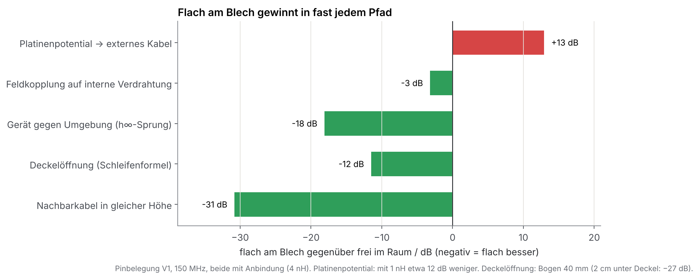

*Abbildung 12: Unterschied flach am Blech gegenüber frei im Raum je Pfad, beide mit Anbindung, V1, 150 MHz.*

Flach am Blech gewinnt in vier von fünf Pfaden deutlich. Das deckt sich mit der Praxis, in der ein frei geführtes Flachband sehr viel stärker abstrahlt. Der eine Gegenpfad erklärt, warum die erste Modellversion „frei im Raum“ zu gut aussehen ließ.

- **Gerät gegen Umgebung (− 18 dB für flach):** Mit Anbindung ist das Blech Rückleiter; das flache Kabel ist fast so symmetrisch wie eine Leiterbahn auf der Platine.

- **Deckelöffnung (− 12 dB, Bogen 2 cm unter dem Deckel − 27 dB):** Schleifenformel mit Spiegelstrom im Boden (Abbildung 10).

- **Nachbarkabel in gleicher Höhe (− 31 dB):** Spiegelströme im Blech kompensieren das Feld (Abbildung 8).

- **Feldkopplung auf feste Verdrahtung (− 3 dB):** Engere Feldbindung und größerer Strom heben sich weitgehend auf.

- **Platinenpotential über die Bolzen (+ 13 dB für flach):** Das flache Kabel führt etwa viermal so viel Gleichtaktstrom (32 statt 134 Ω). Bei V1 fließt der Rückstrom dann überwiegend im Blech und über die Bolzen. Mit 4 nH entsteht dort eine spürbare Spannung, mit ≤ 1 nH nicht mehr.

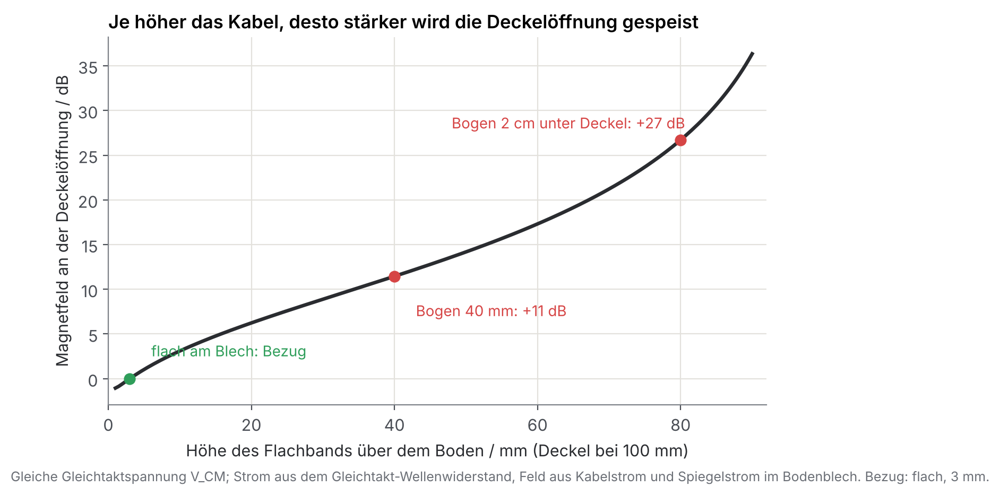

*Abbildung 10: Feld an einer Deckelöffnung (Deckel 100 mm über dem Boden) über der Kabelhöhe, bei gleicher Gleichtaktspannung.*

Wie stark „frei im Raum“ insgesamt verliert, hängt davon ab, wie viel der Geräteanregung nach außen dringt (Abbildung 13). Bei dichtem Gehäuse und 4 nH Anbindung dominiert der Bolzenpfad, und frei im Raum liegt knapp vorn. Mit Display-Fenster oder Kunststofffront oder mit ≤ 1 nH Anbindung liegt flach am Blech vorn – in der Praxis der Normalfall.

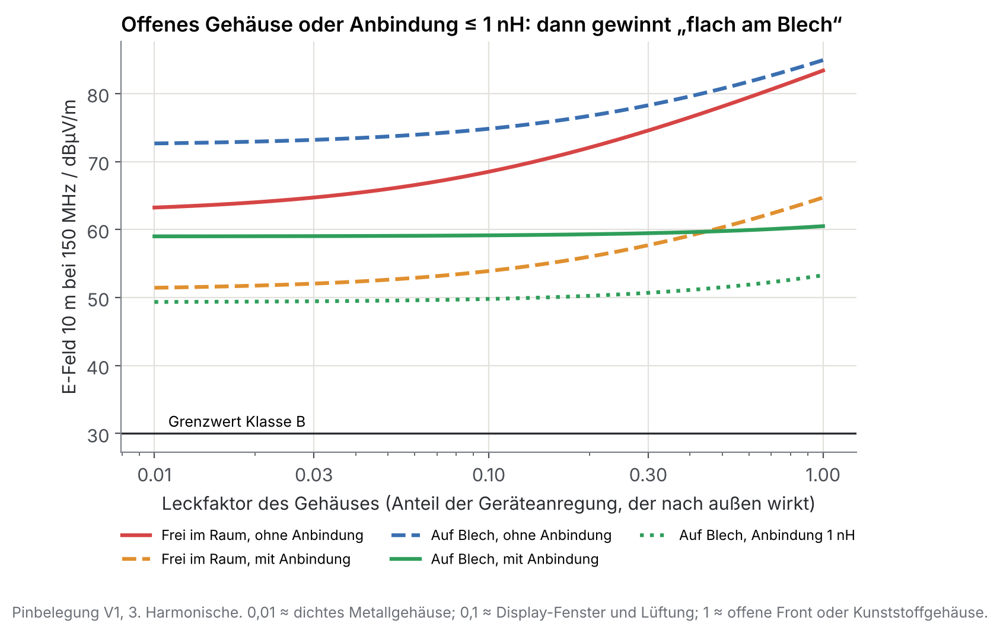

*Abbildung 13: Feldstärke bei 150 MHz über dem Leckfaktor des Gehäuses, V1. Gepunktet: flach am Blech mit 1 nH Anbindung.*

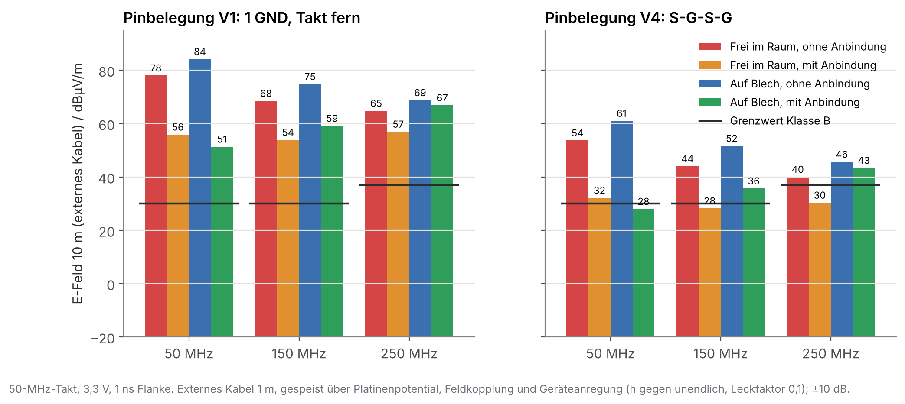

*Abbildung 6: Geschätzte Feldstärke in 10 m bei 50, 150 und 250 MHz, links V1, rechts V4.*

**Anbindungsinduktivität** (Abbildung 9): Damit die flache Führung auch im externen Pfad gewinnt, muss die Anbindung niederinduktiv sein.

| Anbindung (Kabel flach, V1)                   | 50 MHz | 150 MHz | 250 MHz | 350 MHz |
|-----------------------------------------------|--------|---------|---------|---------|
| 4 nH (2 Bolzen)                               | 51     | 59      | 67      | 86      |
| 2 nH                                          | 48     | 54      | 59      | 65      |
| 1 nH                                          | 46     | 50      | 54      | 58      |
| 0,5 nH (Bolzen + flächiger Kontakt)           | 45     | 47      | 50      | 53      |
| Vergleich: frei im Raum, ohne Anbindung       | 78     | 69      | 65      | 63      |
| Vergleich: frei im Raum, mit Anbindung (4 nH) | 56     | 54      | 57      | 64      |

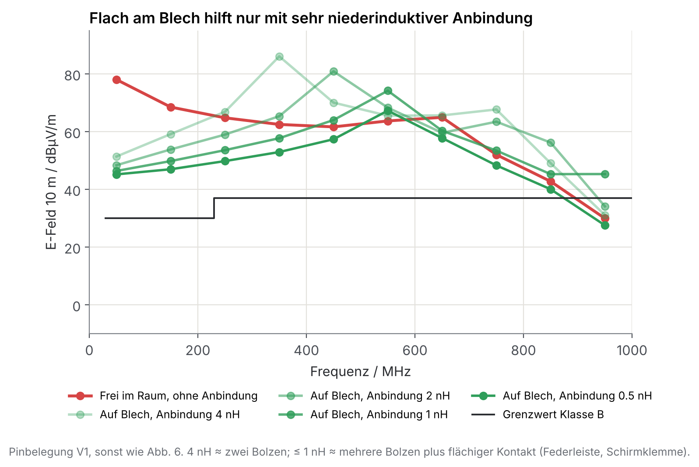

*Abbildung 9: Flach am Blech mit 4 bis 0,5 nH Anbindung gegenüber dem schlechten Fall. Oberhalb ~500 MHz dominieren Resonanzen.*

**Folgerung für die Praxis:** Flach auf Blech und Chassisanbindung gehören zusammen. Die Anbindung muss direkt am Stecker sitzen und sehr niederinduktiv sein: mehrere Bolzen, Massefläche der Platine mit vielen Vias, besser flächiger Kontakt (Federleiste, Kontaktfeder unter dem Stecker). Oberhalb ~400 MHz helfen zusätzlich kurze Kabel und ein Ferrit auf dem Flachband, der die Resonanzen dämpft.

## Gute und schlechte Praxis im Überblick

Die Tabelle ordnet die Maßnahmen nach ihrer Wirkung in den Simulationen; Punkte ohne Simulation sind als Erfahrungswerte gekennzeichnet.

| Thema            | Schlecht                                     | Gut                                                      | Wirkung                                     |
|------------------|----------------------------------------------|----------------------------------------------------------|---------------------------------------------|
| GND-Anteil       | 1 GND für 20 Adern                           | jede 2. Ader GND, beide Ränder GND                       | h 0,5 → 0,04: − 23 bis − 27 dB V_CM         |
| Lage des Takts   | am Rand oder neben Analogsignal              | innen, zwischen zwei GND                                 | Übersprechen − 20 dB, Kopplung − 59 dB      |
| Analogsignale    | direkt neben Takt im selben Kabel            | eigenes Kabel oder GND-Abstand                           | 0,7–1,1 V → \< 0,1 V Spitzen                |
| Chassisanbindung | Platinen schwimmend oder Bolzen nur an Ecken | Bolzen direkt am Stecker, \< 1 nH                        | Platinenpotential − 35 dB bei 50 MHz        |
| Führung          | Bogen frei im Raum                           | flach auf Blech, ≤ 3 mm                                  | Kopplung auf Nachbarkabel − 31 dB           |
| Kombination      | flach auf Blech, aber Platinen schwimmend    | flach auf Blech **und** angebunden                       | ohne Anbindung + 10 dB schlechter als frei  |
| Länge            | Überlänge, Schlaufen                         | kürzeste Länge, flache 45°-Faltung                       | Kabelresonanzen höher (Erfahrungswert)      |
| Öffnungen        | über Lüftung, Display-Fenster, Fugen         | ≥ 3 cm Abstand                                           | Nahfeld fällt mit Abstand² (Erfahrungswert) |
| Nachbarkabel     | parallel gebündelt mit Netz/Ausgang          | getrennt, Kreuzung 90°                                   | siehe Abbildung 8                           |
| Versorgung       | VCC-Adern als „Rückleiter“ gezählt           | VCC nur mit Abblockung an beiden Enden als HF-Rückleiter | (Erfahrungswert)                            |
| Schirm           | Folienschirm über Pigtail angebunden         | Schirm flächig an beiden Enden aufs Chassis              | (Erfahrungswert)                            |
| Ferrit           | als einzige Maßnahme                         | als Ergänzung gegen Resonanzen \> 300 MHz                | dämpft Resonanz, ersetzt keine Anbindung    |
| Kabeltyp         | Standard-Flachband für schnelle Busse        | Twisted-Pair-Flachband oder differentiell                | (Erfahrungswert)                            |

**Rangfolge:** 1. Pinbelegung, 2. Chassisanbindung am Stecker, 3. flache Führung, 4. Länge und Abstand zu Öffnungen, 5. Ferrit als Reserve.

## Grenzen des Modells

Die Rechnungen sind 2D- und Leitungsmodelle mit idealisierten Annahmen. Die Richtungen der Ergebnisse sind belastbar, absolute dB-Werte nicht.

- **Isolation und Dielektrikum** fehlen; PVC (ε_r ≈ 3–4) erhöht Kapazitäten und macht das Medium inhomogen. Dann entsteht auch Vorwärts-Übersprechen, das in Luft null ist.

- **Übrige Signaladern** sind im h-Modell weggelassen. Real liegen sie über Treiber und Abblockung teilweise auf Massepotential und senken h etwas.

- **Rückstromaufteilung** auf zwei GND-Nachbarn ist bei V4 symmetrisch angenommen; das idealisiert die − 59 dB magnetische Kopplung.

- **Gleichtaktmodell:** eine Leitung, zwei Platinen als konzentrierte Elemente, pauschale Güte 10. Die Resonanzfrequenzen hängen stark von Länge, Platinengröße und Bolzen ab.

- **Feldstärke:** Formel für kurzen Dipol, oberhalb der Resonanz begrenzt auf den Halbwellendipol, ungünstigste Richtung. Gehäuseöffnungen und Abstrahlung des Flachbands selbst sind nicht enthalten.

- **Verifikation:** Vor Aussagen gegenüber Kunden mit einer HF-Stromzange am externen Kabel messen (Vorher/Nachher). Die Simulation zeigt, wo sich das Messen lohnt.

**Leckfaktor:** Wie viel der Geräteanregung nach außen wirkt, hängt von Öffnungen, Fugen und Buchsen ab und ist hier pauschal angesetzt (0,01 dicht bis 1 offen). Messbar ist er indirekt über die Stromzange am externen Kabel.

## Für die LaTeX-Präsentation

Alle Abbildungen liegen als Vektor-PDF (für \includegraphics) und PNG vor, im 16:9-tauglichen Format mit einheitlicher Schrift und Farbcodierung (rot = schlecht, grün = gut). Dazu kommen ein Beamer-Gerüst folien.tex mit 18 Folien und das Skript sim.py, das alle Abbildungen neu erzeugt.

| Folie | Inhalt                                 | Datei                                 |
|-------|----------------------------------------|---------------------------------------|
| 1     | Titel                                  | –                                     |
| 2     | Kernaussagen                           | –                                     |
| 3     | Formeln h und V_CM                     | –                                     |
| 4     | Untersuchte Pinbelegungen              | 01_pinbelegungen.pdf                  |
| 5     | Feldbild V1 vs. V4                     | 02_feldbilder.pdf                     |
| 6     | h über der Höhe                        | 03_h_ueber_hoehe.pdf                  |
| 7     | Übersprechen und Schleifeninduktivität | 04_uebersprechen_induktivitaet.pdf    |
| 8     | Magnetische Kopplung                   | 08_magnetische_kopplung.pdf           |
| 9     | Seitenansicht schlecht/gut             | 07_seitenansicht.pdf                  |
| 10    | Platinenpotential                      | 05_uebertragung_platinenpotential.pdf |
| 11    | Feldstärke externes Kabel              | 06_feldstaerke_spektrum.pdf           |
| 12    | Anbindungsinduktivität                 | 09_anbindungsinduktivitaet.pdf        |
| 13    | Rangfolge der Maßnahmen                | –                                     |

Neu: Folie „Warum flach? Deckelöffnung“ mit 10_deckeloeffnung.pdf, im Gerüst nach der Feldstärke-Folie eingefügt.

Neu: Folien „Zwei Bezugssysteme für h“ (11_h_bezug_unendlich.pdf), „Pfadbilanz“ (12_pfadbilanz.pdf) und „Leckfaktor“ (13_leckfaktor.pdf) sowie eine Formelfolie „Welche Formel wann?“.

**Hinweise:**

- Das Gerüst ist für LuaLaTeX geschrieben (fontspec, babel ngerman). Mit pdfLaTeX fontspec durch fontenc ersetzen.

- Die Abbildungen nutzen die Schrift Inter. Für einheitliches Aussehen in der Präsentation dieselbe Schrift setzen oder in sim.py die Schrift auf die Beamer-Schrift ändern und neu erzeugen.

- Parameter wie Kabellänge, Takt oder Bolzeninduktivität stehen oben in sim.py; ein erneuter Lauf (ca. 1 Minute) aktualisiert alle Abbildungen und kennzahlen.json.

## Quellen

- C. Su, T. Hubing, „Imbalance Difference Model for Common-Mode Radiation From Printed Circuit Boards“, IEEE Trans. EMC 53(1), 2011.

- T. Watanabe, O. Wada et al., Arbeiten zur Gleichtaktentstehung durch Unsymmetrie-Unterschiede, IEICE, 2000–2002.

- C. R. Paul, „Introduction to Electromagnetic Compatibility“, 2. Aufl., Wiley 2006 (Mehrleitersysteme, Übersprechen, Gleichtaktabstrahlung).

- CISPR 32 / EN 55032 (Grenzwerte Klasse A/B).

Literaturangaben aus dem Fachwissen, nicht online nachgeprüft. Simulationen eigene Rechnung.
