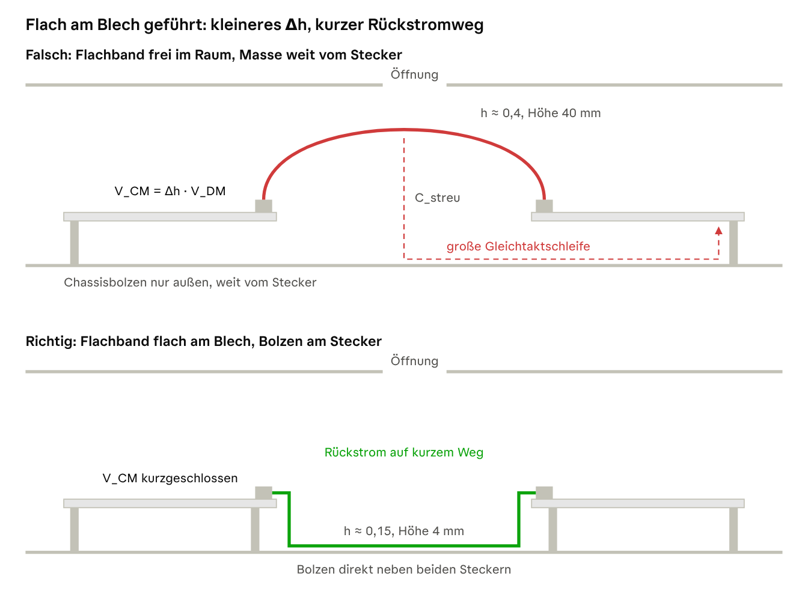

# Imbalance Difference und Gleichtakt-Rückstrom: Kabelführung in Mehrplatinen-Geräten

Stand: 14.11.2026

## Kernaussagen

Gleichtaktstörungen entstehen in einem Mehrplatinen-Gerät fast immer dort, wo sich die Symmetrie des Leitungssystems sprunghaft ändert: am Übergang Platine → Flachbandkabel → Platine oder Display. Die Kabelführung entscheidet, wie groß dieser Sprung ist und welchen Weg der Gleichtakt-Rückstrom nimmt.

- **Ursache:** Eine Gegentaktspannung V_DM erzeugt an jeder Unstetigkeit des Imbalance-Faktors h eine Gleichtaktquelle V_CM = Δh · V_DM.

- **Wirkung:** V_CM treibt einen Gleichtaktstrom über Streukapazitäten zum Gehäuse und zurück. Je größer die Schleife und je höher Δh, desto mehr Strom und Abstrahlung.

- **Kritisch** wird es, wenn dieser Strom auf externe Kabel (Netz, USB, Sensor-/Laserkabel) übergeht oder durch Öffnungen (Display-Fenster, Lüftung, Fugen) austritt. Wenige µA auf einem 1-m-Kabel reichen für Grenzwertüberschreitungen.

- **Abhilfe ohne Redesign:** Flachband kurz und flach auf dem Gehäuseblech führen, Massebelegung im Kabel verbessern, Platinen-Masse direkt am Steckverbinder mit dem Chassis verbinden, Abstand zu Öffnungen und externen Kabeln halten.

## Theorie: Imbalance Difference Model

Das Modell (Watanabe/Wada et al. 2002; Su & Hubing, IEEE Trans. EMC 2011) beschreibt die Umwandlung von Gegentakt in Gleichtakt allein über die Geometrie. Jedes Zweileitersystem – Signalleiter S und Rückleiter R – wird durch seinen Imbalance-Faktor h charakterisiert.

h = \frac{C_S}{C_S + C_R}

C_S und C_R sind die Kapazitäten von Signal- und Rückleiter zur Umgebung (im Gerät: zum Gehäuse). h beschreibt, welcher Anteil des Gegentaktsignals „nach außen sichtbar“ ist.

| Leitungssystem                                       | typisches h | Bedeutung                           |
|------------------------------------------------------|-------------|-------------------------------------|
| Leiterbahn über breiter Massefläche                  | 0,005–0,05  | Rückleiter schirmt fast vollständig |
| Flachband, Signal neben einer GND-Ader, frei in Luft | 0,3–0,5     | nahezu symmetrisch, kaum Schirmung  |
| Flachband G-S-G flach auf Gehäuseblech               | 0,1–0,2     | Blech und Nachbar-GND senken h      |
| Geschirmtes Flachband, Schirm auf Chassis            | \< 0,05     | wie Massefläche                     |

Die Werte sind Größenordnungen zur Orientierung, keine Messwerte.

Konstantes h erzeugt keinen Gleichtakt. Erst wo h springt, entsteht eine Gleichtakt-Spannungsquelle in Reihe zum Rückleiter:

V\_{CM} = \Delta h \cdot V\_{DM} = (h_2 - h_1) \cdot V\_{DM}

Daraus folgen drei Hebel: V_DM klein halten (Pegel, Flanken, Spektrum), Δh klein halten (Kabel ähnlich gut „geschirmt“ wie die Platine) und die Impedanz des Gleichtaktpfads so gestalten, dass der Strom auf kurzem Weg zurückfließt.

## Gleichtakt-Rückstrom: wohin fließt der Strom?

Der Gleichtaktstrom fließt immer in einer geschlossenen Schleife – im Gerät meist als Verschiebungsstrom über Streukapazitäten zum Gehäuse. Die Schleife besteht aus:

1.  dem Kabel selbst (alle Adern gemeinsam, als ein Leiter betrachtet),

2.  der Streukapazität Kabel → Gehäusewand (hängt vom Abstand ab),

3.  dem Gehäuseblech,

4.  der Verbindung Gehäuse → Platinenmasse (Abstandsbolzen, Schrauben, Schirmklemmen) zurück zur Quelle.

Fläche und Impedanz dieser Schleife bestimmen, wie viel Gleichtaktstrom fließt und wie stark er abstrahlt oder einkoppelt. Ein Metallbolzen hat etwa 5–10 nH; bei 100 MHz sind das 3–6 Ω. Sitzt die nächste Chassisverbindung 15 cm vom Steckverbinder entfernt, muss der Rückstrom diesen Umweg über die Platinenmasse nehmen – dort fällt eine Spannung ab, die die gesamte Platine gegenüber dem Gehäuse anhebt.

**Warum ein geschlossenes Metallgehäuse nicht automatisch hilft:** Innen strahlt das Kabel in einen Hohlraum. Problematisch wird das nur, wenn Energie einen Ausgang findet:

- **Externe Kabel:** Die Platinenmasse liegt gegenüber dem Chassis auf Gleichtaktpotential. Jedes Kabel, das an dieser Masse angeschlossen ist und das Gehäuse verlässt, wird zur Antenne.

- **Öffnungen:** Display-Fenster, Lüftungsschlitze und Fugen wirken als Schlitzantennen, wenn ein Kabel mit Gleichtaktstrom dicht daran vorbeiläuft.

- **Nahfeldkopplung:** Das Flachband koppelt kapazitiv und induktiv in Netzzuleitung oder Ausgangskabel hinter deren Filter.

- **Hohlraumresonanzen:** Ein Gehäuse von 30 × 25 × 10 cm hat seine erste Resonanz bei etwa 780 MHz; dort ist die Abstrahlung durch Öffnungen deutlich erhöht.

## Referenzgerät

Betrachtet wird ein Tischgerät im Stil eines Laserdioden-/TEC-Controllers (Klasse Thorlabs ITC): Metallgehäuse, mehrere Platinen, interne Flachbandverbindungen und ein Frontdisplay. Typische Baugruppen:

| Baugruppe                              | Störquelle / Empfindlichkeit                       | Verbindung                                         |
|----------------------------------------|----------------------------------------------------|----------------------------------------------------|
| Netzteil (Schaltregler)                | Schaltflanken 50–500 kHz, Oberwellen bis \> 30 MHz | Litzen zur Hauptplatine                            |
| Hauptplatine (MCU, FPGA, Takt)         | Takte 10–100 MHz, schnelle Busse                   | Flachband zu Front und Treibern                    |
| Treiber-/Analogplatine (LD-Strom, TEC) | empfindlich: pA–mA-Regelung, Rauschen              | Flachband zur Hauptplatine, Ausgangsbuchsen hinten |
| Frontplatine mit Display               | RGB/SPI/LVDS-Takt, Hintergrundbeleuchtungs-Treiber | FFC zum Display, Flachband zur Hauptplatine        |
| Rückwand                               | Netz, USB, LD-/TEC-Kabel nach außen                | Steckverbinder im Blech                            |

Die Rollen sind für die Analyse typisiert; die konkrete Belegung des Kundengeräts ist im Einzelfall zu prüfen. Die kritischen h-Sprünge liegen an jedem Flachband- und FFC-Stecker sowie an jeder Buchse in der Rückwand.

## Falsche vs. richtige Kabelführung

Der größte Einzeleffekt ist die Höhe des Flachbands über dem Gehäuseblech: Sie bestimmt h des Kabels und damit Δh am Stecker, und sie bestimmt die Fläche der Gleichtaktschleife.

Schnitt durchs Gehäuse · falsche und richtige Führung

Oben speist das hochgebogene Kabel die Öffnung und der Rückstrom läuft bis zum entfernten Bolzen; unten bleibt die Schleife wenige Millimeter hoch und endet am Bolzen neben dem Stecker.

Drehbare 3D-Ansicht eines hypothetischen Geräteinneren mit sechs Punkten schlechter und guter Praxis: [Innenleben 3D](innenleben3d.html).

| Szenario                | Falsch                                                 | Folge                                  | Richtig                                                   | Wirkung                                |
|-------------------------|--------------------------------------------------------|----------------------------------------|-----------------------------------------------------------|----------------------------------------|
| Höhe über Blech         | Bögen frei in Luft, 3–5 cm über den Platinen           | h ≈ 0,4, große Schleife                | flach auf Blech, \< 5 mm, geklebt oder geclipst           | h sinkt, Schleifenfläche ÷ 10 und mehr |
| Länge                   | Überlänge zu Schlaufen gerollt oder zusammengeknuddelt | Resonanzlänge, Kopplung in sich        | kürzeste Länge, Richtungswechsel durch flache 45°-Faltung | weniger Antenne, Resonanz höher        |
| Nähe zu Öffnungen       | über Display-Fenster, Lüftung, Deckelfuge              | Schlitzantenne wird gespeist           | mindestens 2–3 cm Abstand, Blechbereich ohne Öffnung      | Austritt verhindert                    |
| Nähe zu externen Kabeln | parallel zu Netz-, USB- oder LD-Kabel gebündelt        | Kopplung hinter dem Filter             | getrennte Wege, Kreuzung unter 90°                        | Filter bleibt wirksam                  |
| Nähe zu Störquellen     | über Schaltregler oder Trafo geführt                   | Magnetfeld koppelt ein                 | um das Netzteil herum, Blechwand dazwischen               | Einkopplung entfällt                   |
| Chassisanbindung        | Platinenmasse nur an einem Punkt, weit vom Stecker     | Rückstrom-Umweg, Platine „schwimmt“    | Metallbolzen direkt neben beiden Steckern                 | Gleichtaktspannung kurzgeschlossen     |
| Display                 | Metallrahmen floatend, FFC frei über Fenster           | Rahmen und FFC strahlen durchs Fenster | Rahmen mehrfach aufs Chassis, FFC flach auf Rahmen        | Fenster bleibt dunkel                  |

Die Maßnahmen kombinieren sich: Ein flach geführtes Kabel ohne Chassisanbindung am Stecker lässt den h-Sprung bestehen, und eine gute Anbindung hilft wenig, wenn das Kabel direkt am Display-Fenster liegt.

## Flachband-Belegung, Display-FFC und Masseanbindung

Die Belegung legt h des Kabels fest, bevor es überhaupt verlegt wird. Ein Signal, dessen Rückleiter zehn Adern entfernt liegt, bildet eine große Gegentaktschleife und hat ein hohes h.

| Belegung (40-polig)                                   | GND-Adern | Bewertung                                  |
|-------------------------------------------------------|-----------|--------------------------------------------|
| 1 × GND am Rand, Rest Signale                         | 1         | schlecht: große Schleifen, h hoch          |
| GND an beiden Rändern + Mitte                         | 3         | mittel: Randsignale weit vom Rückleiter    |
| S-G-S-G … (jede 2. Ader GND)                          | 20        | gut: jedes Signal neben eigenem Rückleiter |
| G-S-G für Takte, S-G-S-G für den Rest, Außenadern GND | 20–22     | sehr gut, Standard für Takte \> 10 MHz     |

**Regeln für die Belegung:**

- Takte und schnelle Busse innen, zwischen zwei GND-Adern, nie an der Außenkante.

- Außenadern immer GND: die Kante hat die schwächste Kopplung zum Rest.

- Analoge Regelsignale (LD-Strom, TEC-Sensor) auf ein eigenes Kabel oder räumlich getrennt mit GND-Adern dazwischen.

- Versorgungsadern sind für HF keine Rückleiter, solange sie nicht beidseitig gut abgeblockt sind.

**Display:** Der Display-Takt ist oft der stärkste Störer im Gerät, und das Fenster ist die größte Öffnung. Der Metallrahmen des Moduls wird an mindestens zwei Punkten kurz mit dem Chassis verbunden. Das FFC liegt flach auf dem Rahmen oder Blech. Wo möglich, Flanken der Display-Signale per Serienwiderstand (22–47 Ω) entschärfen.

**Masseanbindung:** Jede Platine erhält eine Chassisverbindung unmittelbar neben jedem Flachband-Stecker, ausgeführt als Metallbolzen mit Durchkontaktierung zur Massefläche. Das schließt V_CM am Ort der Entstehung kurz. Die Platine, deren Masse zu den Rückwand-Buchsen führt, wird dort zusätzlich direkt mit dem Rückwandblech verbunden. Bei analogen Messkreisen mit bewusst getrennter Masse ist eine HF-Anbindung über Kondensator (z. B. 10 nF) statt galvanisch zu prüfen.

## Rechenbeispiel

Richtige Führung senkt die Gleichtaktquelle am Stecker um rund 9 dB, die Schleifenkopplung zusätzlich um etwa 20 dB. Annahmen: 50-MHz-Takt, 3,3 V, Anstiegszeit 1 ns, betrachtet wird die 3. Harmonische bei 150 MHz.

**Gegentaktamplitude der 3. Harmonischen** (Trapezsignal, 50 % Tastgrad):

V\_{DM,3} = \frac{2 \cdot 3{,}3\\\mathrm{V}}{3\pi} \cdot \mathrm{sinc}\\\left(\frac{3\pi \cdot 1\\\mathrm{ns}}{20\\\mathrm{ns}}\right) \approx 0{,}67\\\mathrm{V}

| Größe                      | Falsch             | Richtig                           |
|----------------------------|--------------------|-----------------------------------|
| h Platine                  | 0,02               | 0,02                              |
| h Flachband                | 0,40 (frei, 1 GND) | 0,15 (flach, G-S-G)               |
| Δh                         | 0,38               | 0,13                              |
| V_CM = Δh · V_DM           | 255 mV             | 87 mV                             |
| Höhe über Blech (Schleife) | 40 mm              | 4 mm                              |
| Chassisbolzen am Stecker   | nein               | ja, schließt V_CM zusätzlich kurz |

**Wie viel Strom auf einem externen Kabel ist zu viel?** Für ein 1 m langes Kabel gilt näherungsweise (kurzer Dipol, ungünstigste Richtung):

E \approx 1{,}257 \cdot 10^{-6} \cdot \frac{f \cdot I\_{CM} \cdot L}{d}

Bei 150 MHz und 10 m Abstand ergibt der Grenzwert Klasse B (30 dBµV/m) etwa **1,7 µA**, Klasse A (40 dBµV/m) etwa **5,3 µA**. Von mehreren hundert Millivolt Gleichtaktspannung im Gerät muss also nur ein winziger Bruchteil auf ein Ausgangskabel gelangen. Die Zahlen sind Abschätzungen; im Einzelfall entscheidet die Messung.

## Checkliste und Messverfahren

**Checkliste Kabelführung**

- [ ] Jedes Flachband liegt flach auf dem Gehäuseblech (\< 5 mm), fixiert mit Klebepad oder Clip.

- [ ] Keine Schlaufen; Überlänge vermieden, Richtungswechsel als flache Faltung.

- [ ] Mindestens 2–3 cm Abstand zu Display-Fenster, Lüftungsschlitzen und Deckelfugen.

- [ ] Kein Flachband parallel zu Netz-, USB- oder Ausgangskabeln; Kreuzungen unter 90°.

- [ ] Keine Führung über Schaltregler, Drosseln oder Trafo.

- [ ] Belegung: Außenadern GND, Takte zwischen zwei GND-Adern.

- [ ] Chassisbolzen direkt neben jedem Flachband-Stecker, beide Platinenseiten.

- [ ] Display-Rahmen mehrfach aufs Chassis, FFC flach auf Rahmen.

- [ ] Externe Kabel: Schirm 360° an der Durchführung, Filter direkt an der Rückwand.

**Messverfahren zur Lokalisierung**

1.  **Stromzange (HF-Stromwandler) auf jedes externe Kabel**, 1–5 cm vor dem Gehäuse: misst I_CM direkt. Mit den Grenzwerten aus dem Rechenbeispiel vergleichbar – schnellster Indikator für Abstrahlprobleme.

2.  **Stromzange auf das Flachband** im Gerät: vorher/nachher bei veränderter Führung. Zeigt direkt die Wirkung jeder Maßnahme.

3.  **Nahfeldsonde (H-Feld) über Öffnungen und Fugen** bei geschlossenem Deckel: findet die Austrittsstellen.

4.  **Probeweise Klappferrit** aufs Flachband: Sinkt der Pegel am externen Kabel, ist der Kopplungspfad bestätigt. Der Ferrit ist Diagnose, nicht die bevorzugte Lösung.

5.  **Pre-Compliance-Messung** im Absorberraum oder mit GTEM-Zelle nach Umsetzung, Vergleich mit Ausgangszustand.

## Quellen

- T. Watanabe, O. Wada et al., „Common-mode current generation caused by difference of unbalance of transmission lines on a printed circuit board with narrow ground pattern“, IEICE Trans. Commun., 2000/2002.

- C. Su, T. Hubing, „Imbalance Difference Model for Common-Mode Radiation From Printed Circuit Boards“, IEEE Trans. EMC 53(1), 2011.

- C. R. Paul, „Introduction to Electromagnetic Compatibility“, 2. Aufl., Wiley 2006 (Gleichtaktabstrahlung von Kabeln).

- CISPR 32 / EN 55032 und EN 61326-1 (Grenzwerte Klasse A/B).

Angaben aus dem Fachwissen zusammengestellt, nicht online nachgeprüft.
