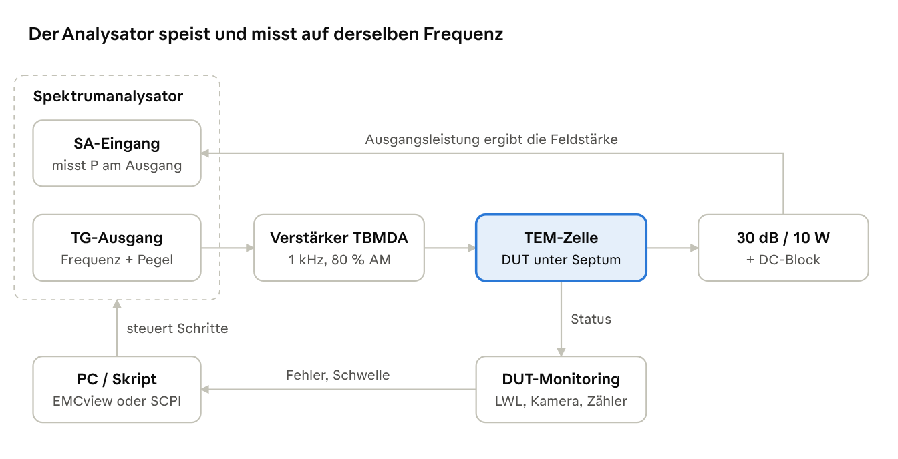

# Konzept: Radiated Immunity Precompliance mit Nahfeldsonden & TekBox-TEM-Zellen

Stand: 14.11.2026

## Ziel und Kurzfassung

Ziel ist ein zweistufiger Labortest, der Störfestigkeitsprobleme gegen gestrahlte HF-Felder findet und behebt, bevor das Produkt ins akkreditierte Labor geht. Stufe 1 setzt das ganze Board oder Gerät in einer TekBox-TEM-Zelle einem definierten Feld aus (Ja/Nein, mit Pegelreserve). Stufe 2 sucht mit Nahfeldsonden die empfindliche Stelle und prüft Gegenmaßnahmen.

- **Referenz:** IEC/EN 61000-4-3 (80 MHz bis 6 GHz, 1 kHz / 80 % AM, Schrittweite 1 %, Verweilzeit ≥ 0,5 s). Pegel aus der Produkt- oder Fachgrundnorm, z. B. 3 V/m (Wohnbereich, EN 61000-6-1) oder 10 V/m (Industrie, EN 61000-6-2, bis 1 GHz).
- **Abgrenzung:** Ersetzt keine Normprüfung. Die TEM-Zelle liefert ein homogenes Feld nur in kleinem Volumen und eine Polarisation; Kabel koppeln anders als im 1,5 × 1,5 m-Feld der Absorberhalle. Ergebnisse sind relativ (vorher/nachher) und als Pegelreserve zu lesen.
- **Erfolgskriterium Precompliance:** Kein Fehler bis Zielpegel + 6 dB, in allen drei Orientierungen, über den gesamten Frequenzbereich, den die Zelle abdeckt.
- **Ohne Schirmraum:** Möglich, wenn Leistung und Abstrahlung klein bleiben, Funkdienste geschont werden und geschlossene oder geleitete Verfahren den Großteil übernehmen (Abschnitt „Ohne Schirmraum“).

## Equipment und Feldstärke-Budget

Schon wenige Hundert Milliwatt reichen für 10 V/m mit Reserve, weil der Septum-Abstand d nur 2,8 bis 15 cm beträgt. TekBox gibt die vereinfachte Beziehung an ([FAQ Open TEM Cells](https://www.batronix.com/files/Tekbox/Datenblaetter/QA_OpenTEMCells.pdf)):

$$
E = \frac{\sqrt{P \cdot 50\,\Omega}}{d} \qquad P_{Spitze,AM80\%} = 3{,}24 \cdot P_{Träger}
$$

Die Formel liefert die maximale Feldstärke mittig zwischen Septum und Wand; für das Mittel über das DUT-Volumen zusätzlich ca. 3 dB einplanen.

### TEM-Zellen

| Zelle | Septumhöhe d | Nutzraum unter Septum | DUT-Höhe (≤ d/3) | P für 10 V/m, AM-Spitze | P für 20 V/m (10 V/m + 6 dB), AM-Spitze | Preis (UK, Telonic) |
| --- | --- | --- | --- | --- | --- | --- |
| TBTC0 | 2,8 cm | Modulebene | ≤ 1 cm | 5 mW (7 dBm) | 20 mW (13 dBm) | £ 421 |
| TBTC1 | 5 cm | ca. 20 × 39 cm Grundfläche | ≤ 1,7 cm | 16 mW (12 dBm) | 65 mW (18 dBm) | £ 562 |
| TBTC2 | 10 cm | 23 × 28 × 10 cm | ≤ 3,3 cm | 65 mW (18 dBm) | 260 mW (24 dBm) | £ 750 |
| TBTC3 | 15 cm | 36 × 48 × 15 cm | ≤ 5 cm | 146 mW (22 dBm) | 580 mW (28 dBm) | £ 937 |

Nutzbare Obergrenze hängt von der Größe ab: kleine Zellen (TBTC0/1) reichen bis in den GHz-Bereich, die TBTC2 war in einem Praxistest bis 1 GHz nahezu flach ([Interference Technology](https://interferencetechnology.com/?p=47162)), die TBTC3 deutlich darunter. S21 und S11 der eigenen Zelle mit Tracking-Generator einmal ausmessen und als Korrekturkurve ablegen. Die beiliegende 50-Ω-Last begrenzt auf 25 W ([Distek](https://www.distek.ro/en/Product/TEKBOX_Tekbox-Open-Tem-Cells-For-EMC-Pre-Compliance-Testing-5422)).

### Verstärker (TekBox TBMDA, mit eingebauter Modulation)

| Verstärker | Frequenz | P max | max. E in TBTC1 / TBTC2 / TBTC3 | Rolle |
| --- | --- | --- | --- | --- |
| TBMDA1 | 40–3500 MHz | 22 dBm | 56 / 28 / 19 V/m | GHz-Bereich, kleine Zellen |
| TBMDA2 | 10–1500 MHz | 27 dBm | 100 / 50 / 33 V/m | Allrounder für TBTC2 |
| TBMDA3(B) | 10–1000 MHz | 37–40 dBm | 317 / 158 / 106 V/m | Hauptverstärker, auch Sonden, BCI, CDN |
| TBMDA4(B) | 0,1–50 (75) MHz | 37 dBm | 317 / 158 / 106 V/m | Unter 80 MHz, Sonden, geleitete Tests |

Werte laut TekBox-FAQ. Alle TBMDA bieten 1 kHz / 80 % AM sowie Pulsmodulation 1 kHz / 50 % und 217 Hz / 12,5 % (GSM-TDMA-ähnlich) und lassen sich direkt vom Tracking-Generator ansteuern ([TBMDA3B](https://www.testequity.com/product/20000331-TBMDA3B), [TBMDA4](https://tequipment.net/TekBox/TBMDA4/Amplifiers-/-Preamps-/-Preamplifiers)). Achtung Oberwellen: Der TBMDA3B hat bei Volllast typ. 31 % THD; bei Ausfällen prüfen, ob die Oberwelle die Ursache ist, oder 6 dB unter Kompression fahren.

### Übrige Komponenten

- **Spektrumanalysator mit Tracking-Generator** (z. B. Rigol DSA800-TG, Siglent SSA3000X, R&S FPC): Quelle und Pegelmonitor in einem. TekBox EMCview steuert den TG schrittweise für Immunitätstests.
- **Leistungsdämpfungsglied** 30 dB / 10 W am Zellenausgang (liegt TBMDA3B/4B bei), dazu DC-Block.
- **Nahfeldsonden-Satz** mit H-Feld-Schleifen (mehrere Durchmesser) und E-Feld-Sonde; für Einspeisung die zulässige Eingangsleistung laut Datenblatt prüfen.
- **DUT-Monitoring:** Akku- oder gefilterte Versorgung, Lichtwellenleiter-UART/USB oder Kamera auf Display/LEDs, Fehlerzähler in der Firmware.
- **Isolierender Abstandshalter** (Styrodur, 5–10 mm), Ferrite für Kabel, Klebeband zur reproduzierbaren Lage.

## Aufbau A: Feldtest in der TEM-Zelle

Die TEM-Zelle beantwortet die Frage „hält das Board X V/m mit Reserve?“ für Baugruppen bis wenige Zentimeter Höhe. Speisung an einem Port, 50-Ω-Last oder 30-dB-Dämpfung plus Analysator am anderen.

1. **Zelle charakterisieren (einmalig):** Leer, TG → Zelle → SA-Eingang. S21 und mit Richtkoppler S11 aufnehmen. Frequenzen mit Resonanzen oder S11 > −10 dB markieren; dort sind Ergebnisse unsicher.
2. **Feld kalibrieren:** Leistung am Zellenausgang über das 30-dB-Glied messen; daraus E per Formel. Optional eine kleine kalibrierte E-Feldsonde (isotrop, faseroptisch) in der DUT-Position für eine Stichprobenkontrolle.
3. **DUT platzieren:** Mittig unter dem Septum auf 5–10 mm Abstandshalter, Höhe ≤ d/3. Mit DUT erneut S21 prüfen; fällt die Durchgangsleistung um mehr als ca. 1 dB, Leistung am Ausgang nachregeln (Ausgangsleistung ist das Maß für das Feld).
4. **Kabel führen:** Versorgung und Monitoring möglichst über Glasfaser oder Akku. Sind echte Kabel nötig, definierte Länge (z. B. 20 cm) parallel zum Septum im Feld führen und am Zellrand mit Ferriten abschließen; die Lage fotografieren und für jeden Durchlauf gleich halten.
5. **Orientierungen:** Die Zelle erzeugt nur vertikale E-Polarisation. DUT in drei (besser sechs) Lagen testen: Bauteilseite oben, hochkant längs, hochkant quer.
6. **Sweep fahren:** 1 kHz / 80 % AM, Schritte 1 % (Grob-Scan 2–5 %), Verweilzeit ≥ 0,5 s bzw. länger als die DUT-Reaktionszeit. Zusätzlich 217 Hz Puls bei Funkprodukten oder Geräten in Handy-Nähe.
7. **Schwellenmodus:** Bei jedem Fehler die Leistung in 1-dB-Schritten zurücknehmen bis zur Fehlerfreiheit. Ergebnis ist eine Schwellen-Kurve E_Fehler(f) statt nur Pass/Fail; sie zeigt Reserve und Verbesserung durch Maßnahmen.

Die offene TEM-Zelle strahlt ab und nimmt Umgebungssignale auf. Daher Leistung nur so hoch wie nötig, Leerlaufmessung vor jedem Test, und für höhere Pegel ein Schirmzelt verwenden (siehe „Ohne Schirmraum“).

## Aufbau B: Lokalisierung mit Nahfeldsonden

Nahfeldsonden beantworten „wo genau koppelt es ein?“, nicht „wie viel V/m hält es?“. Sie werden eingesetzt, sobald Aufbau A einen Fehler bei einer Frequenz zeigt, oder als schneller Erstscan ohne Zelle. Das Feld ist lokal, stark inhomogen und kaum kalibrierbar, strahlt aber kaum ab, weil die Sonde ein schlechter Fernfeldstrahler ist.

- **Signalkette:** TG → TBMDA3/4 (Modulation an) → Sonde. Mit 20–30 dBm beginnen, nur bei Bedarf erhöhen. Die Sonde ist für den Verstärker eine Fehlanpassung; TBMDA verträgt das laut Hersteller, Leerlauf und Kurzschluss aber nicht. Zulässige Sondenleistung laut Datenblatt beachten.
- **H-Feld-Schleife** für Leiterbahnen, Schleifen, Masseschlitze, Quarze, Reset- und Enable-Leitungen; Ebene der Schleife parallel zur Leiterbahn drehen für maximale Kopplung. Große Schleife zum Suchen, kleine zum Eingrenzen.
- **E-Feld-Sonde** für hochohmige Knoten: Analogeingänge, Sensorleitungen, ungenutzte Pins, ADC-Referenz, Steckerpins.
- **Fester Frequenzpunkt:** Die Fehlerfrequenz aus Aufbau A CW+AM einstellen, Sonde in 1–2 mm Abstand in einem Raster über die Platine führen. Bei Fehler die Leistung reduzieren und die Stelle mit der niedrigsten Fehlerschwelle markieren.
- **Schwellenkarte:** Pro Rasterpunkt minimale Fehlerleistung notieren (Tabelle oder Foto mit Markierungen). Mit 3D-Halter oder Koordinatentisch reproduzierbar; das entspricht dem Prinzip des Surface-Scan nach IEC 62132-9.
- **Maßnahme prüfen:** Filter, Ferrit, Kondensator, Pull-up, Schirmblech oder Layout-Änderung einbauen, gleiche Stelle gleiche Leistung erneut, dann zurück in Aufbau A für den Gesamtnachweis.
- **Gegenprobe Emission:** Mit derselben Sonde am SA-Eingang (TG aus) lässt sich die Kopplungsstelle oft auch passiv finden: Wo das Board selbst bei f stark abstrahlt, koppelt es meist auch bei f ein (Reziprozität).

## Signalkette, Kalibrierung und Monitoring

Der Spektrumanalysator mit Tracking-Generator ist Quelle und Pegelmesser zugleich: Der TG treibt den Verstärker, der SA-Eingang misst über 30 dB Dämpfung die Leistung am Zellenausgang auf genau derselben Frequenz. Damit ist jeder Frequenzschritt automatisch dokumentiert.

Der Pegel am Zellenausgang ist das Maß für das Feld; der PC verknüpft jeden Frequenzschritt mit dem DUT-Status.

- **Pegelregelung (Substitution):** Leer-Zelle, Sollfeld je Frequenz über Ausgangsleistung einstellen und TG-Pegel als Tabelle speichern (Ausgleich für Verstärker-Gang von typ. 2,5 dB und Zellen-S21). Im Test diese Tabelle abspielen und die Ausgangsleistung mitloggen; Abweichung > 1 dB markieren.
- **Träger vs. Spitze:** Kalibrieren mit unmoduliertem Träger auf Zielpegel, dann AM 80 % einschalten. Der Verstärker muss die Spitze (+5,1 dB) noch linear liefern; 1-dB-Kompressionspunkt aus dem Datenblatt mit dieser Reserve vergleichen.
- **Schrittbetrieb:** Kein schneller Wobbel. Entweder EMCview mit TG-Steuerung, Zero-Span pro Frequenz, oder ein Skript über SCPI (Python/pyvisa): Frequenz setzen, Pegel setzen, Verweilzeit, Leistung lesen, DUT-Status lesen, protokollieren.
- **Schutz:** DC-Block und ausreichende Dämpfung vor dem SA-Eingang (TBMDA3B bis ca. 40 dBm, SA meist max. +20 bis +30 dBm). Verstärker nie ohne Last einschalten.
- **DUT-Monitoring ohne Rückkopplung:** Lichtwellenleiter-Konverter für UART/CAN/USB, Kamera auf Display, Firmware-Zähler für Resets, CRC-Fehler, ADC-Abweichung. Funktionskriterien A/B/C nach Fachgrundnorm vorher festlegen (z. B. ADC-Wert ± 2 % = A).
- **Protokoll pro Lauf:** Frequenz, Soll-E, gemessene Ausgangsleistung, Modulation, Orientierung, Kabellage (Foto), Firmware-Stand, Fehlerart, Schwelle.

## Prüfablauf, Frequenzplan und Bewertung

Der Ablauf geht vom groben Gesamtscan zur gezielten Ursache und zurück zum Gesamtnachweis. Kein einzelnes Werkzeug deckt 150 kHz bis 6 GHz ab, daher ein Frequenzplan je Band.

| Band | Primärer Aufbau | Quelle | Bemerkung |
| --- | --- | --- | --- |
| 0,15–80 MHz | Geleitet (BCI-Zange oder CDN, IEC 61000-4-6) | TBMDA4(B) | Hier koppeln Kabel, nicht das Board; TEM-Zelle nur für Board-Effekte |
| 80–1000 MHz | TBTC2 oder TBTC3 | TBMDA3(B) | Kernbereich IEC 61000-4-3, 10 V/m + 6 dB mühelos |
| 1–3 GHz | TBTC1 oder TBTC0 | TBMDA1 / TBMDA2 | DUT muss klein sein; S11 prüfen |
| 3–6 GHz | Stichproben: Nahfeldsonde, Kleinzelle, GTEM | TBMDA1 bis 3,5 GHz, darüber Signalgenerator + Fremdverstärker | Typische Funkfrequenzen gezielt (2,4 / 5,2–5,8 GHz) |

### Ablauf je Prüfling

1. Funktionskriterien und Monitoring festlegen, Leerlaufmessung der Zelle.
2. Grob-Scan: Zielpegel + 6 dB, Schritte 5 %, 3 Orientierungen.
3. Fein-Scan um jeden Fehler: Schritte 1 %, Schwelle in 1-dB-Schritten bestimmen.
4. Lokalisierung mit Nahfeldsonde bei den Fehlerfrequenzen (Aufbau B).
5. Maßnahme umsetzen, lokal verifizieren, dann voller Scan in der Zelle.
6. Schwellenkurven vorher/nachher übereinanderlegen; Ziel: überall ≥ 6 dB über Normpegel.
7. Bei Freigabe: Kurzbericht mit Aufbaufotos, Kalibrierung und offenem Risiko für den Termin im akkreditierten Labor.

### Bewertungskriterien

| Kriterium | Bedeutung | Beispiel |
| --- | --- | --- |
| A | Bestimmungsgemäßer Betrieb während der Prüfung, Abweichungen innerhalb Spezifikation | ADC-Wert innerhalb ± 2 %, keine Kommunikationsfehler |
| B | Kurzzeitige Beeinträchtigung, selbstständige Erholung | Einzelne CRC-Fehler mit Retry, Display flackert |
| C | Funktionsverlust, Eingriff nötig | Reset, Absturz, Relais fällt ab |

Gestrahlte Störfestigkeit fordert in den Fachgrundnormen in der Regel Kriterium A; die genaue Definition steht in der Produktnorm bzw. im Produktdatenblatt.

## Ohne Schirmraum: Rahmenbedingungen und Alternativen

Ohne Schirmraum funktioniert das Konzept, wenn die Leistung klein bleibt, die Zelle in ein Schirmzelt kommt und geleitete Verfahren den Kabelanteil übernehmen. Die offene TEM-Zelle selbst ist ein Strahler; auch die Fachliteratur empfiehlt Immunitätstests mit offener Zelle in geschirmter Umgebung ([Interference Technology](https://interferencetechnology.com/?p=47162)).

### Spielregeln im offenen Labor

- Aussendungen dürfen Funkdienste nicht stören. Besonders meiden bzw. nur im Zelt: Flugfunk/Navigation 108–137 MHz, BOS/Behördenfunk, Mobilfunkbänder, GNSS 1164–1610 MHz. Im Zweifel mit dem EMV-Verantwortlichen bzw. der Bundesnetzagentur klären.
- Leistung minimal: Erst mit Zielpegel ohne Reserve, Reserve nur im Zelt oder in kurzen Stichproben.
- Leckage messen: Vor jedem Pegel-Upgrade mit SA und Antenne in 1–3 m Abstand prüfen, dass am Arbeitsplatzrand nichts über dem Umgebungsrauschen liegt.
- Personenschutz: Bei Betrieb keine Hände in die Zelle; im Nahbereich der Zelle treten Feldstärken von über 100 V/m auf. Arbeitsschutz nach EMFV beachten.

### Alternativen und Ergänzungen

| Maßnahme | Was sie leistet | Aufwand | Wann einsetzen |
| --- | --- | --- | --- |
| Schirmzelt TekBox TBST-B um die TEM-Zelle | Ca. ≥ 55 dB bis 1 GHz, ≥ 70 dB 1–3 GHz, ≥ 50 dB bis 6 GHz; 86 × 48 × 48 cm fasst TBTC0/1/2 ([Manual](https://www.batronix.com/files/Tekbox/Datenblaetter/TBST_Tents_Manual.pdf), [TS-Corp](https://sites.google.com/a/ts-corp.com.tw/ts/emc-test-電磁相容/emc-shielded-tent/tbst-200100100)) | Mittel | Standardlösung für Pegel mit Reserve; Monitoring per Glasfaser durch die Wand |
| Open-GTEM TBGTC1 im großen Zelt TBST-100/100/200 | 9 kHz–6 GHz, bis 600 W, Feldgleichmäßigkeit < ± 6 dB bis 3 GHz; größere Geräte ([Manual](https://www.electrokit.com/upload/product/41020/41020716/TBGTC1_Manual.pdf)) | Hoch | Komplette Geräte mit Gehäuse, oberhalb 1 GHz |
| Geleitete Einkopplung: BCI-Zange, CDN, EM-Klemme | Speist Störstrom direkt ins Kabel (IEC 61000-4-6, 0,15–80 MHz; BCI auch bis einige 100 MHz); strahlt wenig ab | Mittel | Kabelgebundene Geräte: Unterhalb ca. 300 MHz sind Kabel meist der Haupt-Koppelpfad |
| Direkte Einspeisung (DPI, IEC 62132-4) | Störleistung über Koppelkondensator in einen Pin oder ein Netz; quantifizierbar, praktisch keine Abstrahlung | Gering | Verdacht auf einzelnen Eingang, IC-Vergleich, Filterauslegung |
| Nahfeld-Injektion (Aufbau B) | Lokale Schwachstellensuche, sehr geringe Fernfeldabstrahlung | Gering | Immer als Lokalisierung |
| Selbstgebaute Stripline / Parallelplatte für Kabelbäume (Prinzip ISO 11452-5) | Homogenes Feld entlang eines Kabels | Mittel | Lange Leitungen, die in keine TEM-Zelle passen |
| Reale Funkgeräte als Quelle (PMR446, Smartphone, WLAN/BLE-Modul) | Realistische Alltagsstörer, legal da zugelassene Geräte; Feld mit SA/Feldsonde grob abschätzen | Sehr gering | Schneller Plausibilitätstest, 217-Hz-Effekte, 2,4/5 GHz |
| ISM-Spotfrequenzen (13,56 / 27,12 / 40,68 / 433,92 / 2450 / 5800 MHz) | Stichproben dort, wo Abstrahlung weniger kritisch ist; frei von Regeln sind sie nicht | Gering | Ergänzend, wenn kein Zelt vorhanden |
| Extrapolation bei reduziertem Pegel | Gleichrichtungseffekte in Analogpfaden skalieren näherungsweise mit E²: Offset bei 3 V/m messen, auf 10 V/m hochrechnen (Faktor ca. 11) | Gering | Analoge Messkanäle im Kleinsignalbereich; nicht für digitale Schwellen-Effekte |
| Pre-Scan-Termin im akkreditierten Labor (halber Tag) | Echte Korrelation des eigenen Aufbaus | Mittel | Einmal pro Produktfamilie, um die TEM-Ergebnisse zu kalibrieren |

## Grenzen, Korrelation und Risiken

Die größte Unsicherheit liegt bei den Kabeln, nicht beim Feld. Ein Board, das in der TEM-Zelle 20 V/m hält, kann in der Halle bei 10 V/m ausfallen, wenn dort 1 m Kabel als Antenne wirkt.

| Risiko | Auswirkung | Gegenmaßnahme |
| --- | --- | --- |
| Kabel-Kopplung anders als in der Norm | Zu optimistisch unter ca. 300 MHz | Geleiteten Test (BCI/CDN) ergänzen; Kabel im Normaufbau einmal im Labor korrelieren |
| Nur eine Polarisation, kleines homogenes Volumen | Empfindliche Achse verpasst | 3–6 Orientierungen; DUT-Höhe ≤ d/3 |
| DUT verstimmt die Zelle (S11, Resonanzen) | Feld weicht um mehrere dB ab | S21 mit DUT messen, Ausgangsleistung nachregeln |
| Verstärker-Oberwellen (bis ca. 30 % THD) | Fehler bei 2f oder 3f falsch zugeordnet | 6 dB unter Kompression, bei Verdacht Tiefpass; Gegenprobe bei f/2 |
| Monitoring-Leitungen koppeln ein oder stören | Scheinfehler oder verdeckte Fehler | Glasfaser, Akku, Kamera |
| Gehäuse fehlt beim Board-Test | Zu pessimistisch (oder bei Schlitzen zu optimistisch) | Endtest mit Seriengehäuse in größerer Zelle/GTEM |
| Abstrahlung ins Labor | Funkstörung, eigene Messungen verfälscht | Schirmzelt, minimale Leistung, Leckagemessung |

Korrelationsstrategie: Einmal pro Produktfamilie dieselbe Baugruppe im eigenen Aufbau und im akkreditierten Labor messen. Die Differenz der Fehlerschwellen ergibt einen hauseigenen Korrekturwert, mit dem künftige TEM-Ergebnisse bewertet werden.

## Ausbaustufen und Budget

Stufe 1 deckt mit einer TBTC2 und einem TBMDA3B den wichtigsten Bereich 80 MHz–1 GHz ab; Zelt und geleitete Tests folgen als Stufe 2. Preise sind Händlerpreise in Originalwährung zum Recherchezeitpunkt, ohne Gewähr; vor Bestellung beim deutschen Distributor anfragen.

| Stufe | Komponenten | Richtpreis | Deckt ab |
| --- | --- | --- | --- |
| 1 – Einstieg | TBTC2, TBMDA3B (inkl. 30-dB-Dämpfung, Kabel), Nahfeldsonden-Satz, vorhandener SA mit TG | £ 750 ([Telonic](https://telonic.co.uk/product-category/emc/tem-cells)) + US$ 1.187–1.283 ([TestEquity](https://www.testequity.com/product/20000331-TBMDA3B)) + Sonden | 80 MHz–1 GHz Feld, Lokalisierung |
| 2 – Ohne Schirmraum sauber | Schirmzelt TBST-B, TBMDA4B, BCI-Zange oder CDN, LWL-Monitoring | Zelt 120 × 60 × 60: SEK 24.775 inkl. MwSt. ([Electrokit](https://www.electrokit.com/en/skarmat-talt-120-x-60-x-60cm)); TBMDA4B US$ 1.079 ([TestEquity](https://www.testequity.com/product/20000332-TBMDA4B)) | Reserve-Pegel ohne Abstrahlung, 0,15–80 MHz geleitet |
| 3 – GHz und Geräte | TBTC1 oder TBTC0 + TBMDA1; optional GTEM TBGTC1 im Zelt TBST-100/100/200 | TBTC1 £ 562, TBTC0 £ 421 ([Telonic](https://telonic.co.uk/product-category/emc/tem-cells)); GTEM auf Anfrage | 1–3,5 GHz, komplette Geräte |

Nächster Schritt: Ein Referenzboard mit bekanntem Laborergebnis durch Stufe 1 schicken und daraus den Korrekturwert für künftige Tests ableiten.

## Quellen

- [TekBox FAQ Open TEM Cells](https://www.batronix.com/files/Tekbox/Datenblaetter/QA_OpenTEMCells.pdf)
- [TekBox TEM Cell Manual](https://cdn.shopify.com/s/files/1/1618/2733/files/Tekbox_TEM_Cell_Manual.pdf)
- [TekBox TBGTC1 Manual](https://www.electrokit.com/upload/product/41020/41020716/TBGTC1_Manual.pdf)
- [TekBox TBST-B Shielded Tents Manual](https://www.batronix.com/files/Tekbox/Datenblaetter/TBST_Tents_Manual.pdf)
- [TBMDA3B Datenblatt (TestEquity)](https://www.testequity.com/product/20000331-TBMDA3B)
- [TBMDA4 Datenblatt (TEquipment)](https://tequipment.net/TekBox/TBMDA4/Amplifiers-/-Preamps-/-Preamplifiers)
- [Interference Technology: TEM-Zelle für Emission und Immunität](https://interferencetechnology.com/?p=47162)
